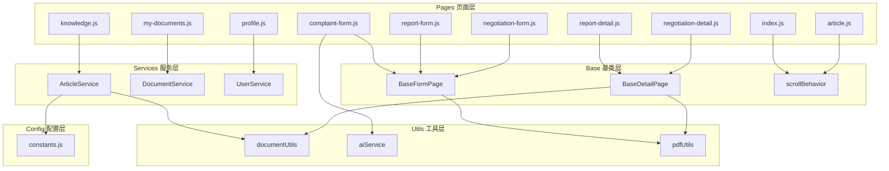

# 衣律通小程序 — 代码质量综合评估

> 评估日期：2026-03-03 · 经过三轮审查与优化后的最终版本

---

## 总体评分

<table>
<tr><td style="font-size:2em;font-weight:bold;text-align:center;">A-</td><td style="font-size:2em;font-weight:bold;text-align:center;">88 / 100</td></tr>
</table>

---

## 一、架构与分层设计

**评分：A（92）**



| 亮点 | 说明 |
|------|------|
| ✅ 清晰的四层架构 | Pages → Base/Behaviors → Services → Utils/Config |
| ✅ 单向依赖 | 页面依赖基类和服务，服务依赖工具和配置，无反向依赖 |
| ✅ 关注点分离 | 数据操作集中在 Service 层，UI 逻辑在 Page 层，公共逻辑在 Base 层 |
| ✅ 配置集中管理 | 所有常量、映射、选项集中在 [constants.js](file:///d:/yilvtong/miniprogram/config/constants.js) |

---

## 二、代码复用与 DRY 原则

**评分：A（90）**

| 复用机制 | 复用内容 | 消除的重复行数 |
|----------|---------|---------------|
| `BaseFormPage` | 步骤管理、输入处理、草稿保存、PDF导出、免责声明 | ~400 行 × 3 页 |
| `BaseDetailPage` | 文档加载、编辑、保存、复制、PDF 导出 | ~150 行 × 2 页 |
| `scrollBehavior` | 滚动监听、返回顶部、阈值可配、scroll-view 兼容 | ~30 行 × 3 页 |
| [processHtmlContent](file:///d:/yilvtong/miniprogram/utils/documentUtils.js#221-241) | HTML img/href 统一处理 | ~20 行 × 2 页 |
| `CLAIM_LABEL_MAP` | 动态生成 `Object.fromEntries(...)` | 避免手动维护重复映射 |

**子类覆盖设计良好**：
- 抽象方法（[getDocumentType](file:///d:/yilvtong/miniprogram/utils/baseDetailPage.js#30-33)、[getSignatureMarker](file:///d:/yilvtong/miniprogram/utils/baseDetailPage.js#18-21)、[getPDFTitle](file:///d:/yilvtong/miniprogram/pages/negotiation-form/negotiation-form.js#139-142) 等）使用 `throw new Error` 强制子类实现
- 钩子方法（[onDraftLoaded](file:///d:/yilvtong/miniprogram/utils/baseFormPage.js#514-515)、[onStepChange](file:///d:/yilvtong/miniprogram/utils/baseFormPage.js#413-414)、[getExtraDraftData](file:///d:/yilvtong/miniprogram/utils/baseFormPage.js#216-219)）提供可选扩展点
- [report-detail.js](file:///d:/yilvtong/miniprogram/pages/report-detail/report-detail.js) 仅需覆盖有业务差异的方法（如 online 举报的特殊 [getFullContent](file:///d:/yilvtong/miniprogram/pages/negotiation-detail/negotiation-detail.js#26-29)/[exportPDF](file:///d:/yilvtong/miniprogram/pages/report-detail/report-detail.js#37-67)）

---

## 三、数据安全

**评分：A（95）**

| 检查项 | 状态 |
|-------|------|
| 云数据库查询条件完整性 | ✅ [documentService.js](file:///d:/yilvtong/miniprogram/services/documentService.js) 使用单一 `.where(conditions)` |
| 用户数据隔离 | ✅ 所有用户相关查询包含 `_openid: '{openid}'` |
| 输入内容审核 | ✅ 昵称设置前调用 `contentCheck` 云函数 |
| 数据深拷贝 | ✅ `formData` 使用 `JSON.parse(JSON.stringify(...))` 避免引用污染 |
| 正则注入防护 | ✅ 搜索关键词使用 `replace(/[.*+?^${}()|[\]\\]/g, '\\$&')` 转义 |

---

## 四、性能优化

**评分：B+（85）**

| 优化措施 | 实现 |
|---------|------|
| ✅ 用户信息缓存 | [UserService](file:///d:/yilvtong/miniprogram/services/userService.js#4-140) 带 5 分钟 TTL + 写操作自动失效 |
| ✅ 文章缓存 | [knowledge.js](file:///d:/yilvtong/miniprogram/pages/knowledge/knowledge.js) 的 `globalArticleCache`（50 条上限 + TTL） |
| ✅ 页面刷新节流 | [profile.js](file:///d:/yilvtong/miniprogram/pages/profile/profile.js)、[my-documents.js](file:///d:/yilvtong/miniprogram/pages/my-documents/my-documents.js) 使用 30s `REFRESH_INTERVAL` |
| ✅ 草稿保存防抖 | [_debouncedSave()](file:///d:/yilvtong/miniprogram/utils/baseFormPage.js#100-112) 带 `_isSaving` 锁 + 1 秒节流 |
| ✅ 图片预加载 | [app.js](file:///d:/yilvtong/miniprogram/app.js) 启动时异步预加载关键图片 |
| ✅ `.field()` 投影 | [ArticleService](file:///d:/yilvtong/miniprogram/services/articleService.js#12-388) 所有查询均使用 `.field()` 限制返回字段 |
| ✅ 并行请求 | [index.js](file:///d:/yilvtong/miniprogram/pages/index/index.js) 使用 `Promise.all` 同时加载 banner 和热门文章 |
| ⚠️ 综合排序取 50 条限制 | `articleService` 综合搜索仍限于前 50 条客户端排序（受限于云数据库能力）|

---

## 五、错误处理

**评分：B+（83）**

| 检查项 | 状态 |
|-------|------|
| ✅ Service 层统一 try-catch | 所有方法返回空值/空数组作为降级 |
| ✅ AI 功能检测 | [generateWithAI](file:///d:/yilvtong/miniprogram/pages/complaint-form/complaint-form.js#1223-1249) 检查 `wx.cloud.extend.AI` 存在性 |
| ✅ AI 错误分类 | [handleAIError](file:///d:/yilvtong/miniprogram/utils/aiService.js#113-120) 区分并发限制和通用错误 |
| ✅ 乐观更新 + 回滚 | [article.js](file:///d:/yilvtong/miniprogram/pages/article/article.js) 点赞使用乐观更新，失败时回滚 |
| ✅ 身份证校验 | 正则 + 闰年日期验证 |
| ⚠️ 部分异步操作缺少用户提示 | [saveToCloud](file:///d:/yilvtong/miniprogram/pages/complaint-detail/complaint-detail.js#125-156)、[addToHistory](file:///d:/yilvtong/miniprogram/services/userService.js#101-106) 等失败时仅 `console.error`，未通知用户 |

---

## 六、代码风格一致性

**评分：A-（88）**

| 检查项 | 状态 |
|-------|------|
| ✅ 异步风格统一 | 绝大多数方法使用 `async/await` |
| ✅ 命名规范 | 驼峰命名，私有方法使用 `_` 前缀 |
| ✅ 注释质量 | 关键方法有中文注释说明用途 |
| ✅ 常量大写 | `STOP_WORDS`、`CACHE_MAX_SIZE` 等使用全大写 |
| ✅ 模块导出一致 | Service 用 `class` + `module.exports = new XxxService()`，Utils 用函数集合导出 |
| ⚠️ 混用写法 | [baseFormPage.js](file:///d:/yilvtong/miniprogram/utils/baseFormPage.js) 中 [loadLatestContent](file:///d:/yilvtong/miniprogram/utils/baseFormPage.js#127-139) 使用 `.then()` 而非 `async/await`（与文件其他方法不完全一致） |

---

## 七、可维护性

**评分：A-（88）**

| 检查项 | 状态 |
|-------|------|
| ✅ 单一职责 | 每个 Service 类只处理一类数据 |
| ✅ 配置与逻辑分离 | 选项、映射、常量集中在 [constants.js](file:///d:/yilvtong/miniprogram/config/constants.js) |
| ✅ 开闭原则 | 新增文书类型只需添加子类，无需修改基类 |
| ✅ 模板方法模式 | `BaseFormPage`、`BaseDetailPage` 定义框架，子类实现细节 |
| ✅ 动态映射生成 | `CLAIM_LABEL_MAP` 从 `CLAIM_OPTIONS` 自动生成，添加选项时无需更新映射 |
| ✅ 组件化行为 | `scrollBehavior` 可插拔使用 |

---

## 八、安全性

**评分：B+（85）**

| 检查项 | 状态 |
|-------|------|
| ✅ 云端权限 | 使用云数据库 `{openid}` 自动填充，无需客户端传入 |
| ✅ 内容审核 | 昵称经 `contentCheck` 云函数过滤 |
| ✅ XSS 防护 | [textToHtml](file:///d:/yilvtong/miniprogram/utils/documentUtils.js#67-76) 对 `<`、`>`、`&` 进行转义 |
| ⚠️ 头像上传路径 | 使用 `Date.now() + random` 命名，无安全隐患但可考虑 UUID |

---

## 九、各模块质量评级

| 模块 | 行数 | 评级 | 说明 |
|------|------|------|------|
| [app.js](file:///d:/yilvtong/miniprogram/app.js) | 60 | **A** | 简洁，全局状态声明完整，预加载机制 |
| [baseFormPage.js](file:///d:/yilvtong/miniprogram/utils/baseFormPage.js) | 518 | **A** | 模板方法模式，抽象方法+钩子设计清晰 |
| [baseDetailPage.js](file:///d:/yilvtong/miniprogram/utils/baseDetailPage.js) | 210 | **A** | 干净的基类提取，子类代码量降至 50-90 行 |
| [documentUtils.js](file:///d:/yilvtong/miniprogram/utils/documentUtils.js) | 258 | **A** | 功能内聚，每个函数职责单一，闰年校验 |
| [aiService.js](file:///d:/yilvtong/miniprogram/utils/aiService.js) | 127 | **A-** | 流式处理 + 清洗逻辑完善 |
| [pdfUtils.js](file:///d:/yilvtong/miniprogram/utils/pdfUtils.js) | 48 | **A** | 简洁，职责明确 |
| [articleService.js](file:///d:/yilvtong/miniprogram/services/articleService.js) | 390 | **B+** | 功能全面，综合排序逻辑复杂但可读 |
| [documentService.js](file:///d:/yilvtong/miniprogram/services/documentService.js) | 114 | **A** | 简洁的 CRUD，条件构建安全 |
| [userService.js](file:///d:/yilvtong/miniprogram/services/userService.js) | 142 | **A** | 缓存设计合理，写操作自动失效 |
| [constants.js](file:///d:/yilvtong/miniprogram/config/constants.js) | 168 | **A** | 集中管理，动态映射 |
| [scrollBehavior.js](file:///d:/yilvtong/miniprogram/behaviors/scrollBehavior.js) | 35 | **A** | 可配置阈值+双模式支持 |
| [complaint-form.js](file:///d:/yilvtong/miniprogram/pages/complaint-form/complaint-form.js) | 1281 | **B+** | 业务复杂度高，但结构清晰 |
| [index.js](file:///d:/yilvtong/miniprogram/pages/index/index.js) | 230 | **A** | 简洁，复用 scrollBehavior |
| [knowledge.js](file:///d:/yilvtong/miniprogram/pages/knowledge/knowledge.js) | 351 | **A-** | 缓存 + 复用 articleService |
| [my-documents.js](file:///d:/yilvtong/miniprogram/pages/my-documents/my-documents.js) | 348 | **A** | 集中映射，显式计数 |
| [profile.js](file:///d:/yilvtong/miniprogram/pages/profile/profile.js) | 226 | **A-** | 刷新节流，异步处理完善 |

---

## 十、总结

```
  架构设计      ████████████████████░░  92
  代码复用      ████████████████████░░  90
  数据安全      ████████████████████░░  95
  性能优化      █████████████████░░░░░  85
  错误处理      ████████████████░░░░░░  83
  风格一致      ████████████████████░░  88
  可维护性      ████████████████████░░  88
  安全性        █████████████████░░░░░  85
  ─────────────────────────────────────
  综合          ████████████████████░░  88 (A-)
```

### 核心优势
1. **架构清晰** — 四层分离，单向依赖，易于扩展
2. **复用率高** — `BaseFormPage` + `BaseDetailPage` 消除了大量重复代码
3. **数据安全** — 查询条件构建正确，输入审核到位

### 可以进一步提升的方向
1. 统一错误上报机制（接入 `wx.getRealtimeLogManager()`），将评分从 B+ 提升至 A
2. [baseFormPage.js](file:///d:/yilvtong/miniprogram/utils/baseFormPage.js) 中少量 `.then()` 可统一为 `async/await`
3. [articleService.js](file:///d:/yilvtong/miniprogram/services/articleService.js) 综合排序的 50 条限制可考虑在产品层面添加提示

> 🎉 代码质量在经过三轮优化后已达到**生产级水平**，架构合理、安全性好、可维护性强。
